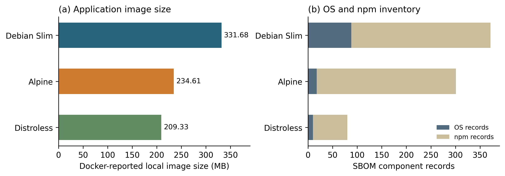
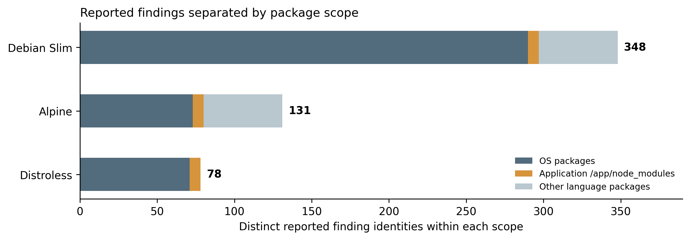
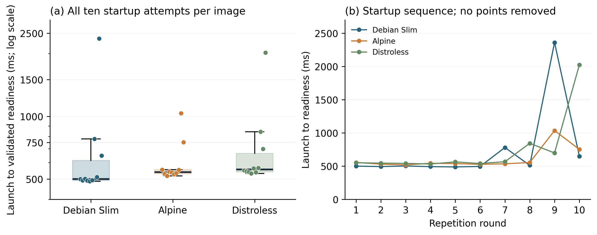
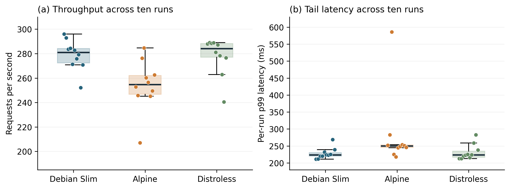
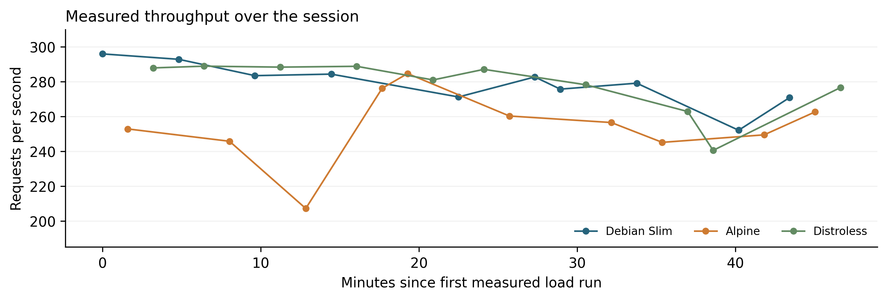
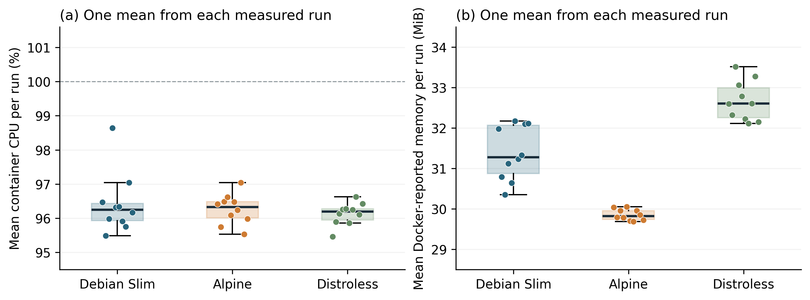

INFORMATION SECURITY  /  ANALIZË E REZULTATEVE

Siguria dhe operueshmëria
e imazheve minimale

Security and Operability Trade-offs in Minimal Container Images: A Controlled Comparison of Debian Slim, Alpine and Distroless

Eksperimenti kryesor: 27 tetor 2026. Ky është raport analize për përgatitjen e seminarit, jo punimi final në format IEEE.

**242 kontrolle të përputhjes së të dhënave kaluan.** U rillogaritën në mënyrë të pavarur 30 matje nisjeje, 30 prova ngarkese dhe 3,600 mostra burimesh. Të 486,585 përgjigjet e përfunduara të raportuara në provat e ngarkesës ishin HTTP 200; nuk u raportuan gabime transporti ose timeout-e.

Rezultatet kryesore

| Imazhi | Madhësia MB | Nisja ms | Kërkesa/s | p99 ms | RAM MiB |

| --- | --- | --- | --- | --- | --- |

| Debian Slim | 331.68 | 501.0 | 280.95 | 223.5 | 31.28 |

| Alpine | 234.61 | 540.5 | 254.70 | 250.0 | 29.82 |

| Distroless | 209.33 | 557.0 | 284.07 | 223.5 | 32.60 |

Vlerat janë medianat e 10 provave për imazh. CPU dhe RAM përmblidhen fillimisht si mesatare brenda çdo prove; më pas llogaritet mediana ndërmjet provave. p99 është mediana e percentileve p99 të provave, jo p99 e të gjitha kërkesave të bashkuara.

**Madhësia dhe përbërja.** Distroless ka madhësi lokale të raportuar nga Docker 209.33 MB, rreth 36.89% më të ulët se Debian Slim. Megjithatë, të tre imazhet mbartin të njëjtat 7 gjetje në varësitë e aplikacionit.

**Performanca.** Alpine ka 9.34% më pak kërkesa/s sipas medianës dhe 4.67% më pak RAM se Debian Slim në këtë ngarkesë. Diferenca e medianës Distroless-Debian është vetëm +1.11%; mesatarja e kërkesave/s është 278.05 kundrejt 278.86. Nuk del një epërsi e qëndrueshme nga çdo statistikë.

**Operueshmëria.** U verifikua krijimi dhe rikuperimi i 9 kombinimeve defekt-imazh. Nuk u kryen prova të pavarura me kohë diagnostikimi; orientimi i asistuar nga Edison përjashtohet nga çdo krahasim i tillë.

Kushtet e krahasimit

| Elementi | Vlera e regjistruar |

| --- | --- |

| Hosti | Ubuntu 26.04.1 në WSL2; Ryzen 5 5600H; 12 CPU logjike; 6.7 GiB RAM |

| Kontejneri | 1 CPU; 256 MiB; non-root; e njëjta arkitekturë amd64 |

| Runtime dhe ngarkesa | Node.js 22.22.0 në imazhe; /compute; 32 lidhje; 30 s ngrohje + 60 s matje |

| Burimi | container-benchmark-current.zip; snapshot efa3288a7a96 |

---

01  Përbërja dhe gjetjet e sigurisë

Figura 1. Madhësia e raportuar nga Docker dhe regjistrimet SBOM të OS/npm. MB = 1,000,000 bytes. Regjistrimet SBOM nuk janë numër unik varësish të aplikacionit.

| Imazhi | OS | npm | Gjithsej SBOM | Varësi unike të aplikacionit |

| --- | --- | --- | --- | --- |

| Debian Slim | 88 | 283 | 372 | 69 |

| Alpine | 18 | 283 | 302 | 69 |

| Distroless | 10 | 70 | 81 | 69 |

Figura 2. Gjetjet ndahen sipas rrugës së paketës. Identiteti është (ID e dobësisë, emër pakete, version). Në këtë dataset kategoritë nuk mbivendosen; totali i tyre përputhet me totalin global.

| Imazhi | OS | Aplikacioni | Paketa të tjera | Gjithsej |

| --- | --- | --- | --- | --- |

| Debian Slim | 290 | 7 | 51 | 348 |

| Alpine | 73 | 7 | 51 | 131 |

| Distroless | 71 | 7 | 0 | 78 |

Të 69 çiftet unike emër-version në /app/node_modules përputhen. Edhe 7 identitetet e gjetjeve të aplikacionit janë të njëjta. Debian dhe Alpine kanë 51 gjetje shtesë në paketat e tjera të gjuhës; numri më i vogël i Distroless nuk tregon se varësitë e aplikacionit janë korrigjuar.

Numrat varen nga inventari, burimet e këshillimeve dhe klasifikimi i skanerit. Nuk janë numër unik CVE-sh dhe nuk provojnë shfrytëzueshmëri. Madhësia është metrika lokale e Docker .Size, jo madhësi transferimi nga registry. Syft raporton një madhësi tjetër; këto baza nuk duhen përzier.

---

02  Nisja dhe ndryshueshmëria gjatë raundeve

Figura 3. Majtas: të gjitha matjet e nisjes, me bosht logaritmik. Djathtas: e njëjta evidencë sipas raundit, me bosht linear. Pikat ekstreme nuk janë hequr.

| Imazhi | Medianë ms | Q1 - Q3 ms | Min - Max ms | Dështime |

| --- | --- | --- | --- | --- |

| Debian Slim | 501.0 | 493.5 - 614.0 | 488 - 2359 | 0 / 10 |

| Alpine | 540.5 | 531.3 - 554.8 | 518 - 1035 | 0 / 10 |

| Distroless | 557.0 | 542.0 - 665.0 | 532 - 2022 | 0 / 10 |

Çfarë tregon matja

Debian Slim ka medianën më të ulët të kohës deri në gatishmëri: 501 ms. Alpine është 540.5 ms dhe Distroless 557 ms. Koha përfshin docker run, publikimin e portit, nisjen e procesit dhe validimin e /healthz me HTTP 200 dhe JSON status=ok. Imazhet ishin tashmë lokale; shkarkimi nuk përfshihet.

Vlerat më të larta janë 2359 ms për Debian, 1035 ms për Alpine dhe 2022 ms për Distroless. Kohët rriten në disa nga raundet e fundit për të tre familjet. Kjo tregon ndryshueshmëri gjatë sesionit, por nuk identifikon shkakun: nuk kemi seri të temperaturës, frekuencës CPU ose ngarkesës së hostit për ta shpjeguar.

Si duhet interpretuar

Raportohen mediana, Q1, Q3, minimumi dhe maksimumi. IQR = Q3 - Q1; këto kuartile nuk janë intervale besimi. Nuk u përzgjodhën vetëm provat e shpejta dhe nuk u hoqën pika ekstreme. Një matje e vetme minimale do ta përfaqësonte dobët këtë sjellje.

Rendi u rastësua brenda raundeve, por rastësimi nuk garanton balancim të pozicioneve. Për ngarkesën, Debian u ekzekutua i pari në 7 nga 10 raunde. Frekuencat e plota ruhen te tables/load_order_frequencies.csv.

---

03  Performanca dhe ecuria kohore

Figura 4. Çdo pikë përfaqëson një provë 60-sekondëshe. Kutia tregon kuartilet; vija e brendshme medianën. Para çdo prove u kryen 30 sekonda ngrohje. Të gjitha pikat, përfshirë p99=586 ms të Alpine, janë të dukshme.

| Imazhi | Kërkesa/s medianë [Q1, Q3] | p50 ms medianë | p99 ms medianë |

| --- | --- | --- | --- |

| Debian Slim | 280.95 [272.37, 284.15] | 107.5 | 223.5 |

| Alpine | 254.70 [246.69, 262.05] | 119.0 | 250.0 |

| Distroless | 284.07 [277.04, 288.28] | 107.5 | 223.5 |

Figura 5. Të 30 provat sipas kohës reale të fillimit. Lidhjet tregojnë ecurinë e së njëjtës familje imazhi; ato nuk provojnë marrëdhënie shkakësore.

Debian dhe Distroless kanë rezultate të afërta. Mediana favorizon lehtë Distroless, ndërsa mesatarja e provave favorizon lehtë Debian. Prandaj nuk pretendohet se Distroless është përgjithësisht më i shpejtë. Alpine ka medianë më të ulët të kërkesave/s dhe p99 më të lartë në këtë aplikacion.

Ngarkesa është CPU-intensive dhe përdor të njëjtën rutinë SHA-256. Ndryshimet midis familjeve përfshijnë bibliotekat dhe ndërtimin e runtime-it, jo vetëm madhësinë. Nuk është provuar që musl ose një komponent i caktuar shkakton diferencën. Nuk janë kryer teste të paracaktuara të rëndësisë statistikore.

---

04  CPU, memoria dhe kufijtë e monitorimit

Figura 6. Çdo pikë është mesatarja e 120 mostrave të një prove. Grafikët nuk i trajtojnë 3,600 mostrat si prova të pavarura. Vija 100% në CPU i referohet një CPU-je në shkallën e raportimit të Docker.

| Imazhi | CPU % medianë [Q1, Q3] | RAM MiB medianë [Q1, Q3] |

| --- | --- | --- |

| Debian Slim | 96.243 [95.927, 96.435] | 31.278 [30.871, 32.066] |

| Alpine | 96.324 [96.006, 96.484] | 29.817 [29.736, 29.953] |

| Distroless | 96.190 [95.949, 96.272] | 32.601 [32.250, 32.992] |

CPU mesatare është rreth 96% sipas këtij monitorimi. Alpine ka medianën më të ulët të memories: 29.817 MiB; Debian 31.278 MiB dhe Distroless 32.601 MiB. Një imazh më i vogël në disk nuk nënkupton automatikisht më pak RAM gjatë ekzekutimit.

Ndjeshmëria ndaj mostrës së parë

Në të 30 provat, mostra e parë CPU është dukshëm më e ulët se mostrat e mëvonshme. Si kontroll eksplorues, u rillogarit mediana duke hequr vetëm këtë mostër të parë. Rezultati kryesor mbetet ai me të gjitha mostrat; kjo analizë nuk u përdor për të zëvendësuar vlerat e raportuara.

| Imazhi | CPU kryesore % | Pa mostrën e parë % | Diferenca pp |

| --- | --- | --- | --- |

| Debian Slim | 96.243 | 97.046 | 0.803 |

| Alpine | 96.324 | 97.126 | 0.802 |

| Distroless | 96.190 | 96.992 | 0.801 |

Ndryshimi është rreth 0.8 pikë përqindjeje për të tre imazhet. Nuk tregon një avantazh të madh CPU për ndonjërin. Mostrat e Docker mund të jenë të korreluara dhe skedarët nuk kanë timestamp për çdo mostër; mesataret janë aritmetike, jo mesatare të peshuara sipas kohës.

Memoria është fusha MemUsage e Docker, e konvertuar në MiB; nuk etiketohet si RSS e pastër e procesit Node.js. Përmbledhja nuk mat konsumin e gjithë hostit ose të gjeneratorit të ngarkesës.

---

05  Operueshmëria, kufizimet dhe gjurmueshmëria

| Imazhi | Konfigurimi | Lejet | Lidhja | Mënyra |

| --- | --- | --- | --- | --- |

| Debian Slim | Verifikuar | Verifikuar | Verifikuar | Manuale me asistencë |

| Alpine | Verifikuar | Verifikuar | Verifikuar | Automatike |

| Distroless | Verifikuar | Verifikuar | Verifikuar | Automatike |

APP_MODE bosh shkaktoi dalje me kodin 1; lejet shkaktuan EACCES në /file; adresa stub-wrong shkaktoi dështim të /upstream. Pas korrigjimit kaluan të 5 testet për secilin kombinim. Për lejet u përdor një kontejner ndihmës; për konfigurimin dhe lidhjen u rikrijua kontejneri. Konfigurimi non-root u ruajt.

**Nuk ka kohë të vlefshme të diagnostikimit.** Sesioni i planifikuar me Donartin nuk u realizua si studim i pavarur. Edison kreu një orientim të asistuar për konfigurimin në Distroless; ai është i përjashtuar nga krahasimi i kohëve dhe nuk numërohet si provë e dhjetë e pavarur. Nuk mund të pretendohet se një imazh kërkon më shumë minuta ose hapa për diagnostikim.

Përgjigjja ndaj pyetjeve kërkimore

**RQ1.** Inventari dhe gjetjet totale ndryshojnë; 7 gjetjet në varësitë e aplikacionit mbeten identike. **RQ2.** Funksionaliteti i testuar dhe rikuperimi u ruajtën. Inventari dokumenton kufizimet e mjeteve të brendshme, por nuk mat përpjekjen e operatorit. **RQ3.** Madhësia lokale, nisja, memoria dhe performanca kanë kompromise; asnjë variant nuk dominon çdo metrikë në këtë eksperiment.

Kufijtë e përfundimeve

Një aplikacion JavaScript, një host WSL2 dhe një profil /compute kufizojnë përgjithësimin. Përputhshmëria e varësive native nuk u testua. Nuk u testuan shfrytëzime, arratisje nga kontejneri ose rezistencë ndaj sulmeve; inventari dhe gjetjet janë tregues të sipërfaqes së sulmit.

Hosti kishte karikuesin të lidhur; ngarkesa 1-minutëshe e regjistruar para matjeve ishte 1.34 pas fazave të përgatitjes. Nuk ka seri monitorimi të hostit gjatë sesionit. Burimet e seriozitetit mund të ndryshojnë sipas distribucionit. Nuk u përfshinë binari i databazës Trivy, build-i i Windows-it ose versioni i plotë i programit WSL në arkivin burimor.

Evidenca dhe riprodhimi

audit.json përmban hash-in e arkivit, hash-et e inputeve dhe 242 kontrollet e kaluara. Manifesti SHA-256 i databazës përputhet midis pilotit dhe eksperimentit kryesor; metadata e databazës përputhet me hash-in. Binari trivy.db mungon, prandaj hash-i i tij nuk mund të rillogaritej në këtë analizë. Logjet e skanimit regjistrojnë kontrollet origjinale OK.

Kodi në nisjen e eksperimentit: f8d6bb95ec18; snapshot i dorëzuar: efa3288a7a96. Burimi: container-benchmark-current.zip. Grafiqet dhe CSV-të gjenerohen nga scripts/analyze_results.py. ChatGPT/Codex asistoi përgatitjen dhe analizën; matjet janë nga ekzekutimet e regjistruara të përdoruesit.

Shënim: ky raport dokumenton analizën empirike. Literatura, kontributet reale të anëtarëve dhe punimi final IEEE duhen finalizuar veçmas.
